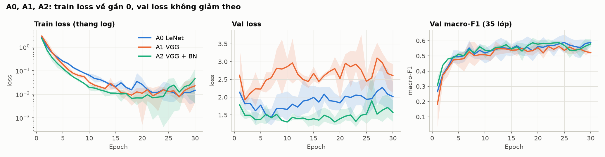
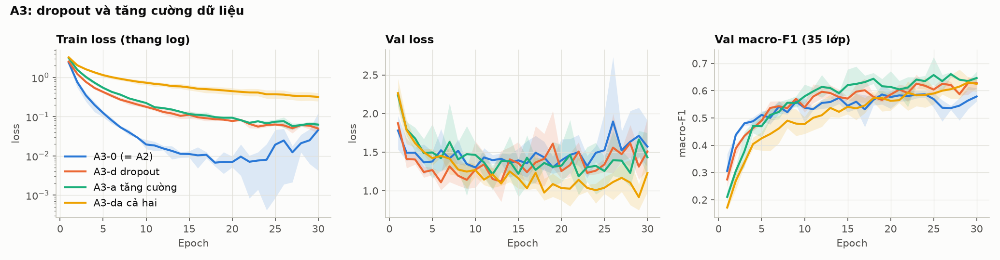
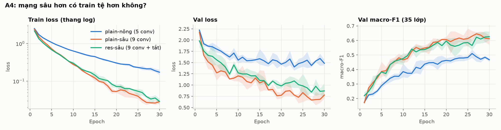
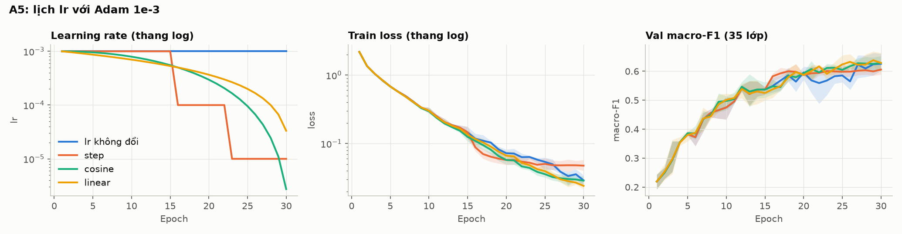
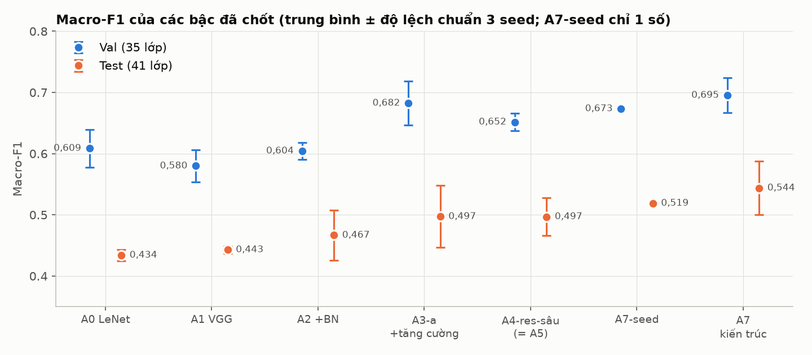
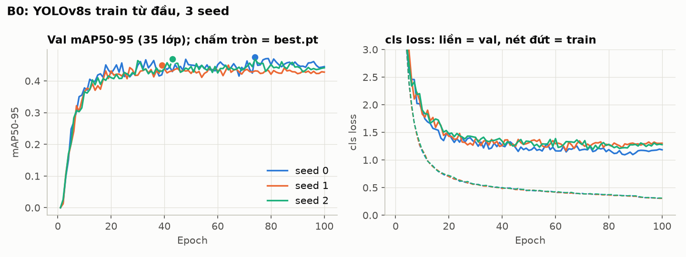
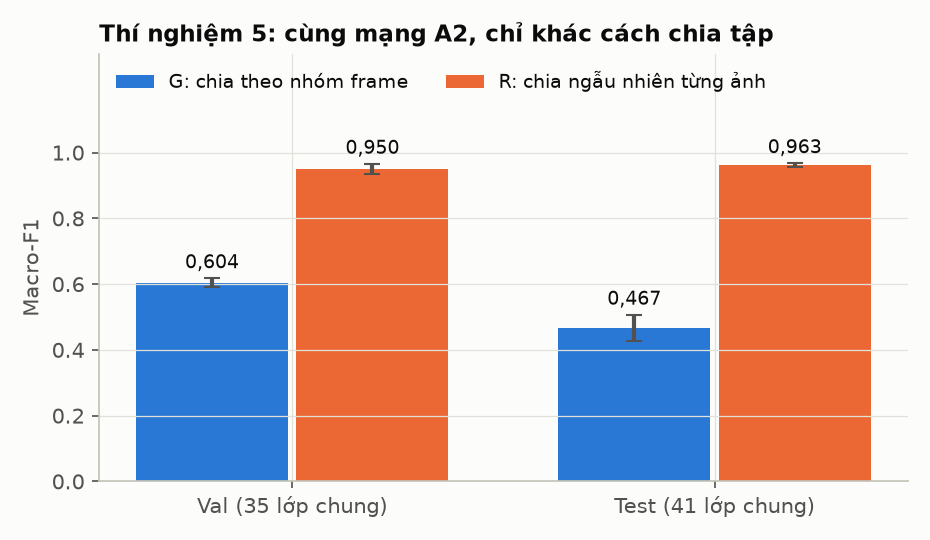
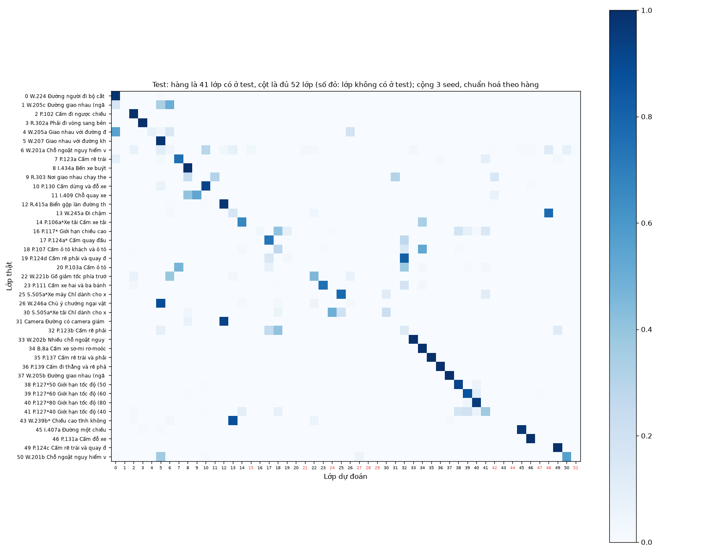

# Nhận diện biển báo giao thông Việt Nam bằng mạng tích chập tự xây

**Bài tập lớn môn Học sâu (IT4653), Đại học Bách khoa Hà Nội**

| | |
|---|---|
| Sinh viên | Dũng (MSSV: ...) |
| Mã nguồn | repo này, nhánh `dung/bao-cao` |
| Ngày | 2026-11-24 (bản nháp đầu) |

Báo cáo ghép từ sổ [`NHAT_KY.md`](../NHAT_KY.md) và bảng [`ket_qua/ket_qua.csv`](../ket_qua/ket_qua.csv). Mỗi con số trong báo cáo đều có ở hai file đó; chỗ nào lấy từ đâu đã ghi kèm. Bảng tính tay đầy đủ của từng mạng ở [`ket_qua/bang_tham_so.md`](../ket_qua/bang_tham_so.md).

**Quy ước số liệu.**
- Mỗi cấu hình chạy 3 seed (0, 1, 2). Báo cáo trung bình ± độ lệch chuẩn mẫu (chia n − 1).
- **Val có 35 lớp, test có 41 lớp** (mục 2.3 giải thích vì sao). Mọi macro-F1 và mAP đều tính trên các lớp có mặt trong tập đó, trừ khi ghi khác.
- Dấu thập phân là dấu phẩy.

---

## Tóm tắt

Bài toán: nhận ra 52 loại biển báo giao thông Việt Nam trong ảnh camera hành trình quay ở TP.HCM (3191 ảnh, 8329 box). **Mọi mạng đều tự xây và train từ đầu**, không dùng trọng số đã học trước.

Ba kết quả chính:

1. **Cách chia dữ liệu quan trọng hơn kiến trúc mạng.** Ảnh trong bộ dữ liệu là các frame liền nhau của video. Split gốc chia ngẫu nhiên từng ảnh, nên 612/639 ảnh test có frame liền kề nằm trong train. Nhóm chia lại theo nhóm frame. Cùng một mạng A2, cùng cách train:
   - chia ngẫu nhiên: test macro-F1 **0,963 ± 0,006**;
   - chia theo nhóm frame: **0,467 ± 0,041** (41 lớp chung).

   Con số 0,96 đo khả năng nhớ cảnh đã thấy, không đo khả năng nhận biển ở cảnh mới.
2. **Xây mạng từng bậc giúp được, nhưng ít.** Test macro-F1 (41 lớp) tăng gần như đúng theo thứ tự xây mạng: A0 LeNet 0,434 → A2 VGG + BN 0,467 → A3-a (thêm tăng cường dữ liệu) 0,497 ≈ A4 có kết nối tắt 0,497 → ensemble 3 kiến trúc **0,544 ± 0,044**. Mỗi bậc liền kề chỉ hơn nhau cỡ một độ lệch chuẩn.
3. **Cái khó nằm ở dữ liệu.** Nhiều lớp chỉ có 1–4 cảnh quay ở train. Khi cảnh test khác cảnh train, recall rơi về gần 0. Cỡ ảnh cắt không giải thích được lỗi. Một bộ phát hiện khác hẳn (YOLOv8s train từ đầu, test mAP50-95 **0,343 ± 0,034**) kém ở đúng những lớp mà mạng phân loại kém: tương quan từng lớp là 0,80.

---

## Mục lục

1. [Bài toán và cách làm](#1-bài-toán-và-cách-làm)
2. [Dữ liệu](#2-dữ-liệu)
3. [Hướng A: tự xây mạng phân loại, A0 → A7](#3-hướng-a-tự-xây-mạng-phân-loại-a0--a7)
4. [Hướng B: B0, YOLOv8s train từ đầu](#4-hướng-b-b0-yolov8s-train-từ-đầu)
5. [Phân tích trên test](#5-phân-tích-trên-test)
6. [Trả lời các câu H1–H4](#6-trả-lời-các-câu-h1h4)
7. [Hỏi đáp theo từng phần](#7-hỏi-đáp-theo-từng-phần)
8. [Hạn chế](#8-hạn-chế)
9. [Tái lập kết quả](#9-tái-lập-kết-quả)
10. [Tài liệu tham khảo](#10-tài-liệu-tham-khảo)

---

## 1. Bài toán và cách làm

### 1.1. Bài toán

- **Đầu vào:** ảnh camera hành trình 960×540 hoặc 1920×1080, có thể chứa nhiều biển (trung bình 2,6 biển mỗi ảnh, nhiều nhất 12).
- **Đầu ra:** loại biển, một trong 52 lớp theo QCVN (biển cấm P, nguy hiểm W, hiệu lệnh R, chỉ dẫn I, biển phụ S).
- Biển rất nhỏ: cạnh dài của box có trung vị 36 px trên ảnh gốc, 46,7% box nhỏ hơn 32×32 px.

### 1.2. Hai hướng làm

| Hướng | Làm gì | Vai trò |
|---|---|---|
| **A (chính)** | Cắt vùng biển theo box có sẵn, đưa về 64×64. Tự viết CNN phân loại 52 lớp bằng PyTorch, xây theo bậc A0 → A7, mỗi bậc đổi một yếu tố và gắn với một bài giảng | Phần "tự xây mạng" |
| **B (bổ sung)** | B0: YOLOv8s tạo từ file cấu hình `yolov8s.yaml` (khởi tạo ngẫu nhiên), train từ đầu, phát hiện và phân loại trên cả khung hình | Mốc so sánh. Không phải mạng tự xây: kiến trúc là của Ultralytics |

Hướng A phân loại ảnh cắt từ **box thật**. Nó tương ứng với giai đoạn 2 của một hệ hai giai đoạn, khi giai đoạn 1 (tìm biển) làm hoàn hảo. Vì vậy macro-F1 của hướng A và mAP của B0 **không cùng thước đo**, chỉ so được ở mức ý tưởng (mục 6, H2).

| Bậc | Thay đổi so với bậc trước | Câu hỏi của môn | Bài giảng |
|---|---|---|---|
| A0 | Mạng kiểu LeNet: 2 conv 5×5, pooling, 3 FC | Đếm tham số, kích thước đầu ra | Giáo trình chương 3 |
| A1 | Khối conv 3×3 kiểu VGG, sâu hơn | Vì sao chồng nhiều conv 3×3 | Slide VGG (bài 3) |
| A2 | Thêm BatchNorm | Tham số của BN, train khác suy diễn thế nào, có hội tụ nhanh hơn không | Giáo trình 4.4 |
| A3 | Dropout, tăng cường dữ liệu | Overfitting, giảm được bao nhiêu | Giáo trình 4.7, 4.8 |
| A4 | Khối residual | Mạng sâu có suy biến không | Slide ResNet (bài 3) |
| A5 | Optimizer, lịch lr | SGD + momentum so với Adam, lịch lr | Giáo trình 4.5, 4.6; slide bài 5 |
| A7 | Ensemble | Kết hợp mô hình tăng bao nhiêu, tốn gì | Giáo trình 4.9 |

A6 (tinh chỉnh ResNet-18 đã học trên ImageNet) đã bỏ, vì cô không cho dùng mạng đã học trước. Câu transfer learning trả lời bằng lý thuyết (mục 7.3).

### 1.3. Quy tắc thí nghiệm (đặt trước khi chạy)

1. **Không dùng mạng hoặc trọng số đã học trước.** Không file `.pt` có sẵn, không `pretrained=True`. Ultralytics 8.4.191 tự tải `yolo26n.pt` để kiểm tra AMP trước khi train; nhóm thay hàm `check_amp` để không tải file đó (mục 4.1).
2. **Không lật ảnh.** Nhiều lớp chỉ khác nhau ở chiều trái/phải (cấm rẽ trái / cấm rẽ phải, ngoặt trái / ngoặt phải). Lật ảnh mà giữ nhãn sẽ tạo mẫu sai. YOLO đặt `fliplr=0` (mặc định của Ultralytics là 0,5).
3. **Chọn trên val, test chỉ chấm một lần** cho cấu hình đã chốt. Danh sách chấm test được chốt và ghi vào sổ trước khi chấm (NHAT_KY, mục 2026-11-23, bước 2.4).
4. **Mỗi cấu hình 3 seed**, đổi một yếu tố mỗi lần.
5. **Quy tắc chọn:** trung bình val macro-F1 cao nhất. Nếu chênh lệch nhỏ hơn độ lệch chuẩn thì coi là hoà, chọn bản có độ lệch chuẩn nhỏ hơn.
6. **Ghi phiên bản nhãn:** md5 thư mục nhãn `80a393b981121f57e7080674c2750722` giống nhau ở mọi lần chạy.

**Vì sao dùng macro-F1:** các lớp lệch nhau rất nhiều (lớp ít nhất 5 box, lớp nhiều nhất hàng trăm). Accuracy bị các lớp lớn chi phối. Macro-F1 lấy trung bình F1 của từng lớp, nên lớp nhỏ được tính ngang lớp lớn.

---

## 2. Dữ liệu

### 2.1. Nguồn và quy mô

- Bộ `archive` định dạng YOLO, 52 lớp, ảnh camera hành trình ở TP.HCM.
- Sau khi làm sạch: **3191 ảnh, 8329 box**. Bản gốc giữ nguyên (đã kiểm md5 của 6437 file trước và sau). Mọi sửa đổi làm trên bản copy `data/vn_signs_yolo/`.

### 2.2. Làm sạch nhãn

| Việc | Chi tiết | Mục trong sổ |
|---|---|---|
| Loại 25 ảnh nhãn rỗng | Một số ảnh có biển nhỏ chưa gán nhãn, nên không dùng làm ảnh nền | A3 |
| Xoá 2 box chồng khít khác lớp | Ảnh 1965, 2095: cùng một biển gán hai lớp. Giữ lớp 23 | B1 |
| Sửa 1 box vượt khung ảnh | Ảnh 0248 | B2 |
| Xoay lại 39 ảnh 1319–1357 | Ảnh dọc 540×960 bị xoay 90° cả khung, không có thẻ EXIF. Xoay ảnh và đổi toạ độ box theo `x' = y, y' = 1 − x, w' = h, h' = w`, vẽ lại box để kiểm | C4 |
| Xem bằng mắt 683 box qua catalog | 599 đúng, 80 không rõ (giữ nhãn), 4 sai | G |
| Xoá 3 box lớp 16 bị đánh Sai, chuyển box 1193#2 từ lớp 28 sang lớp 30 | Box 1193#2 là biển "chỉ xe tải". Vì box này là box lớp 28 duy nhất ở test, lớp 28 thành không đánh giá được | C4, C5 |
| Đặt tên lớp tiếng Việt | | C2 |

### 2.3. Chia theo nhóm frame

**Vấn đề.** Ảnh đánh số liền nhau là các frame của video, hai frame liền nhau có tương quan trung vị 0,9. Split gốc chia ngẫu nhiên từng ảnh:
- 612/639 ảnh test có ảnh train liền số;
- 30,7% ảnh test có một ảnh train giống trên 0,95 (tương quan ảnh xám thu nhỏ).

Đây là kiểu rò rỉ đã được ghi nhận: GTSRB chia train/test theo *track* (chuỗi ảnh của cùng một biển) để mọi ảnh của một biển nằm cùng một tập (Stallkamp và cộng sự 2011). Barz và Denzler (2020) cho thấy ảnh gần trùng giữa train và test làm điểm test bị thổi phồng.

**Cách làm** (`du_lieu/scripts/`, log ở `du_lieu/log/`):
1. Tính tương quan giữa ảnh xám thu nhỏ 64×36 của các ảnh.
2. Cắt nhóm khi hai ảnh liền số có tương quan dưới 0,5, hoặc khi đổi kích thước ảnh.
3. Gộp hai nhóm nếu có cặp ảnh tương quan trên 0,95 (cùng cảnh quay lại).
4. Gán **nguyên nhóm** vào một tập bằng simulated annealing (20 lần khởi tạo × 8000 bước, seed 0). Thứ tự ưu tiên: mọi lớp có ở train; lớp có từ 2 nhóm trở lên có mặt ở val và test; tỉ lệ ảnh và box gần 70/15/15.

Không dùng `StratifiedGroupKFold` của scikit-learn vì hàm đó chỉ dành cho mỗi mẫu một nhãn, còn ở đây một ảnh có nhiều box thuộc nhiều lớp.

**Kết quả:**

| | Số ảnh | Box | Số lớp có mặt | Ảnh giống train > 0,95 |
|---|---:|---:|---:|---:|
| train | 2138 | 5621 | 52 | |
| val | 474 | 1078 | **35** | 0,0% |
| test | 579 | 1630 | **41** | 0,0% (split gốc: 30,7%) |

**Cái giá:**
- **11 lớp chỉ có ở train, không đánh giá được** (15, 21, 24, 27, 28, 29, 42, 44, 47, 48, 51). Mỗi lớp này chỉ xuất hiện trong đúng một nhóm frame. Một nhóm phải nằm trọn một tập, nên toàn bộ box của lớp đó chỉ nằm được ở một tập, và thuật toán đặt chúng vào train để mạng còn học được. Đổi seed chia (đo với 5 seed) thì 10 lớp đầu luôn giống hệt nhau, nên nguyên nhân là dữ liệu, không phải seed.
- **6 lớp có ở test nhưng không có ở val** (11, 20, 33, 38, 43, 50). Lúc chọn epoch không ai thấy các lớp này (mục 3.9).
- Chỉ 59–74% ảnh giữ nguyên tập khi đổi seed chia. Điểm test phụ thuộc vào một cách chia cụ thể.

### 2.4. Ảnh cắt cho hướng A

- **Cách cắt** (`src/data/make_crops.py`): hình vuông, tâm là tâm box, cạnh = round(1,2 × cạnh dài box). Phần vượt ra ngoài ảnh đệm bằng pixel mép. Cắt vuông để biển không bị méo; lề 10% mỗi bên theo cách làm của GTSRB.
- **Số ảnh cắt:** train 5621, val 1078, test 1630 (một ảnh cắt mỗi box). Đọc qua `manifest.csv` có `class_id` cố định. Không dùng `ImageFolder`, vì val chỉ có 35 lớp và test 41 lớp, `ImageFolder` sẽ đánh số lớp khác nhau giữa các tập.
- **Kích thước 64×64:** 78,1% box có cạnh dài ≤ 64 px, nên 64×64 giữ được gần hết chi tiết. Đổi lại, 71,4% ảnh cắt có cạnh ≤ 64 px sẽ bị phóng to; phóng to không thêm thông tin. Cạnh ảnh cắt: nhỏ nhất 8 px, trung vị 43 px, lớn nhất 570 px.
- **Chuẩn hoá** bằng mean/std tính trên train (giáo trình 4.2): mean (0,468; 0,437; 0,462), std (0,207; 0,199; 0,208).

---

## 3. Hướng A: tự xây mạng phân loại, A0 → A7

### 3.1. Cấu hình chung

| Thứ | Giá trị |
|---|---|
| Code | `src/models/`, `src/train.py`, `src/evaluate.py`, `src/summary.py` |
| Đầu vào | 3×64×64, chuẩn hoá theo mean/std của train |
| Loss | `CrossEntropyLoss` (softmax nằm trong loss) |
| Optimizer | Adam, lr 1e-3, lr không đổi, weight decay 0 (A5 thử các lựa chọn khác) |
| Batch, số epoch | 128, 30 |
| Chọn checkpoint | epoch có val macro-F1 cao nhất |
| Máy | MacBook M2, GPU qua MPS. Python 3.14.7, PyTorch 2.14.1 |

Mọi số tham số dưới đây được **tính tay trước, rồi kiểm bằng `python -m src.summary --model <tên>`**, khớp hết. Receptive field (RF) chỉ tính tay.

**Ba công thức dùng cho mọi bảng:**

    Kích thước:       N_ra = (N_vào + 2P − F) / S + 1
    Tham số conv:     (F · F · C_vào + 1) · C_ra          (không có +1 nếu bias=False)
    Tham số Linear:   (số_vào + 1) · số_ra
    Receptive field:  r_ra = r_vào + (k − 1) · j_vào,   j_ra = j_vào · s     (bắt đầu r = 1, j = 1)

ReLU, max pool, flatten, dropout, global average pooling có 0 tham số.

### 3.2. A0: kiểu LeNet-5

Code `src/models/a0_lenet.py`.

| # | Lớp | Đầu ra | Tham số | RF | j |
|---|---|---|---:|---:|---:|
| 0 | Đầu vào | 3×64×64 | | 1 | 1 |
| 1 | Conv 5×5, 3→6, S 1, P 0 + ReLU | 6×60×60 | (5·5·3 + 1)·6 = 456 | 5 | 1 |
| 2 | MaxPool 2 | 6×30×30 | 0 | 6 | 2 |
| 3 | Conv 5×5, 6→16 + ReLU | 16×26×26 | (5·5·6 + 1)·16 = 2.416 | 14 | 2 |
| 4 | MaxPool 2 | 16×13×13 | 0 | **16** | 4 |
| 5 | Flatten | 2704 | 0 | | |
| 6 | Linear 2704→120 + ReLU | 120 | 2705·120 = **324.600** | toàn ảnh | |
| 7 | Linear 120→84 + ReLU | 84 | 121·84 = 10.164 | | |
| 8 | Linear 84→52 | 52 | 85·52 = 4.420 | | |
| | **Tổng** | | **342.056** | | |

- **Phần conv chỉ có 2.872 tham số (0,8%).** Riêng Linear 2704→120 chiếm 94,9%. Lý do: một bộ lọc conv dùng chung ở mọi vị trí (chia sẻ trọng số), nên số tham số không phụ thuộc cỡ ảnh; lớp FC có một trọng số riêng cho mỗi cặp (đầu vào, đầu ra).
- RF cuối phần conv là 16×16, một phần tư cạnh ảnh. Mỗi đặc trưng chỉ nhìn một mảng của tấm biển.
- **Khác LeNet-5 gốc** (LeCun và cộng sự 1998):
  - LeNet-5 nhận ảnh xám 32×32, A0 nhận ảnh màu 64×64.
  - LeNet-5 dùng tanh, A0 dùng ReLU (không bão hoà ở vùng dương).
  - LeNet-5 lấy mẫu kiểu trung bình có hệ số học được, A0 dùng max pool không có tham số.
  - Conv thứ hai của LeNet-5 chỉ nối một phần các bản đồ vào theo bảng nối, A0 nối đầy đủ.
  - LeNet-5 ra 10 đơn vị RBF, A0 ra 52 logit.
  - Giữ đúng 6 và 16 kênh, FC 120 và 84.

**Kết quả** (val, 35 lớp): **0,6087 ± 0,0310**, val acc 0,781. Mỗi lần chạy 0,5 phút.

### 3.3. A1: kiểu VGG

Code `src/models/a1_vgg.py`: 3 khối [conv 3×3 → ReLU → conv 3×3 → ReLU → max pool 2] với 32, 64, 128 kênh, rồi FC 256 → FC 52. Mọi conv P = 1, S = 1 nên giữ nguyên cạnh; chỉ max pool làm cạnh giảm một nửa.

| # | Lớp | Đầu ra | Tham số | RF | j |
|---|---|---|---:|---:|---:|
| 1 | Conv 3×3, 3→32 | 32×64×64 | 28·32 = 896 | 3 | 1 |
| 2 | Conv 3×3, 32→32 | 32×64×64 | 289·32 = 9.248 | 5 | 1 |
| 3 | MaxPool 2 | 32×32×32 | 0 | 6 | 2 |
| 4 | Conv 3×3, 32→64 | 64×32×32 | 289·64 = 18.496 | 10 | 2 |
| 5 | Conv 3×3, 64→64 | 64×32×32 | 577·64 = 36.928 | 14 | 2 |
| 6 | MaxPool 2 | 64×16×16 | 0 | 16 | 4 |
| 7 | Conv 3×3, 64→128 | 128×16×16 | 577·128 = 73.856 | 24 | 4 |
| 8 | Conv 3×3, 128→128 | 128×16×16 | 1153·128 = 147.584 | 32 | 4 |
| 9 | MaxPool 2 | 128×8×8 | 0 | **36** | 8 |
| 10 | Flatten | 8192 | 0 | | |
| 11 | Linear 8192→256 | 256 | 8193·256 = **2.097.408** | | |
| 12 | Linear 256→52 | 52 | 257·52 = 13.364 | | |
| | **Tổng** | | **2.397.780** | | |

- Gấp 7 lần tham số của A0. Linear 8192→256 vẫn chiếm 87,5%: sau 3 lần pool còn 8×8 vị trí × 128 kênh = 8192 số, mỗi số nối với cả 256 nơ-ron.
- RF cuối phần conv là 36, hơn nửa cạnh ảnh: sâu hơn, và mỗi lần pool làm j gấp đôi nên các conv sau mở rộng RF nhanh hơn.

**Hai conv 3×3 so với một conv 5×5** (32→32 kênh):

| | RF | Tham số | Số lần ReLU |
|---|---:|---:|---:|
| Hai conv 3×3 | 5 | 2·(3·3·32 + 1)·32 = **18.496** | 2 |
| Một conv 5×5 | 5 | (5·5·32 + 1)·32 = **25.632** | 1 |

Cùng RF, ít hơn 28% trọng số (18C² so với 25C²), thêm một lần phi tuyến. Đây là lập luận của VGG (Simonyan và Zisserman 2014).

**Kết quả** (val, 35 lớp): **0,5799 ± 0,0263**, val acc 0,771. 2,5 phút mỗi lần chạy.

- **A1 không tốt hơn A0**, dù gấp 7 lần tham số và chậm gấp 5 lần. Chênh lệch −0,029 nhỏ hơn độ lệch chuẩn, nên coi là hoà.
- **Overfitting nặng:** train acc khoảng 0,998, val acc 0,77. Val loss nhỏ nhất ở epoch 2–4 (2 trong 3 seed), sau đó tăng lên 2,13–2,93 ở epoch 30 (A0: 1,66–2,42). Hình 1.



*Hình 1. Đường liền là trung bình 3 seed, dải mờ là khoảng từ seed thấp nhất đến seed cao nhất. Train loss về khoảng 0,01–0,05, val loss không giảm theo.*

### 3.4. A2: A1 thêm BatchNorm

Code `src/models/a2_vgg_bn.py`. Chỉ đổi một yếu tố so với A1: mỗi conv thành [conv 3×3, `bias=False` → BatchNorm2d → ReLU].

- **BatchNorm2d(C) có 2C tham số học được:** γ (co giãn) và β (dịch) cho mỗi kênh. Thêm **2C + 1 buffer** không học bằng gradient: running mean, running var và một bộ đếm.
- **Conv đặt `bias=False`** vì BN trừ trung bình của kênh, mọi bias cộng trước đó đều bị trừ mất; β của BN làm thay việc dịch.
- A2 có **2.398.228** tham số, hơn A1 448: bỏ 448 bias (32 + 32 + 64 + 64 + 128 + 128), thêm 896 γ, β. Buffer 902. Kích thước đầu ra và RF không đổi so với A1.

**Lúc train và lúc suy diễn khác nhau** (PyTorch, `momentum=0.1`, `eps=1e-5`):
- **Train** (`model.train()`): mỗi kênh tính μ_B, σ²_B trên cả batch và mọi vị trí (128 ảnh × H × W giá trị), chuẩn hoá x̂ = (x − μ_B)/√(σ²_B + ε), ra y = γx̂ + β. Đồng thời cập nhật running = 0,9·running + 0,1·giá trị của batch.
- **Suy diễn** (`model.eval()`): dùng running mean và var đã tích luỹ. Kết quả của một ảnh không phụ thuộc các ảnh khác trong batch, chạy được với batch 1. `src/evaluate.py` gọi `model.eval()` trước khi chấm.

**Kết quả** (val, 35 lớp): **0,6044 ± 0,0141**, val acc 0,772.

- Hơn A1 0,0245, xấp xỉ độ lệch chuẩn của A1, chưa đủ để nói tốt hơn hẳn. Độ lệch chuẩn giảm gần một nửa: ổn định hơn giữa các seed.
- **Hội tụ nhanh hơn ở các epoch đầu** (trung bình 3 seed), đúng với giáo trình 4.4:

  | Epoch | 1 | 2 | 3 | 5 |
  |---|---:|---:|---:|---:|
  | Train loss A1 | 2,965 | 1,324 | 0,578 | 0,188 |
  | Train loss A2 | 2,399 | 0,758 | 0,350 | 0,125 |
  | Val F1 A1 | 0,184 | 0,372 | 0,420 | 0,477 |
  | Val F1 A2 | 0,306 | 0,438 | 0,480 | 0,511 |

  Epoch đầu tiên đạt val F1 ≥ 0,5: A2 là 5, 4, 5; A1 là 5, 12, 6.
- Val loss ở epoch 30 thấp hơn rõ (1,31–1,91 so với 2,13–2,93): mạng bớt tự tin sai.
- **Overfitting vẫn còn:** khoảng cách train acc − val acc 0,227, gần bằng A1. BN không phải cách chữa overfitting chính.

### 3.5. A3: dropout và tăng cường dữ liệu

Xuất phát từ A2 (A3-0 chính là A2). Ba bản, mỗi bản đổi một yếu tố:

| Bản | Đổi gì so với A2 | Tham số |
|---|---|---:|
| A3-d | `Dropout(p=0,5)` trước FC cuối (`src/models/a3_dropout.py`) | 2.398.228 (dropout 0 tham số) |
| A3-a | Tăng cường: `RandomAffine(10°, dịch 10%, co giãn 0,9–1,1)`, `ColorJitter(độ sáng 0,3, tương phản 0,3)` | 2.398.228 |
| A3-da | Cả hai | 2.398.228 |

- **Không lật, không đổi hue** (màu mang nghĩa của biển). Đã xem 8 ảnh × 5 bản tăng cường để kiểm: không ảnh nào bị lật, biển vẫn trong khung.
- **Dropout đặt sau FC 8192→256**, là lớp chiếm 87,5% tham số, chỗ dễ học thuộc nhất.
- **Dropout lúc train và lúc suy diễn:** lúc train, mỗi phần tử của vector 256 bị đặt về 0 với xác suất 0,5, phần còn lại nhân 1/(1 − p) = 2 để kỳ vọng không đổi (inverted dropout). Lúc suy diễn, dropout trả lại nguyên đầu vào.

**Lưu ý đo:** `train_acc` trong log đo trên ảnh đã tăng cường và lúc dropout đang bật, nên thấp hơn độ chính xác thật trên train. Để so khoảng cách train và val công bằng, chấm lại train ở chế độ eval, không tăng cường (`python -m src.evaluate --split train`), gọi là "train acc sạch".

| Bản | Val macro-F1 | Val acc | Train acc sạch | Khoảng cách acc sạch | Khoảng cách theo log | Val loss nhỏ nhất |
|---|---|---|---|---|---|---|
| A3-0 (A2) | 0,6044 ± 0,0141 | 0,772 | 0,9997 | 0,228 | 0,227 | 1,206 |
| A3-d | 0,6513 ± 0,0075 | 0,786 | 0,9986 | 0,213 | 0,195 | 1,014 |
| **A3-a** | **0,6825 ± 0,0360** | 0,789 | 0,9945 | 0,205 | 0,186 | 1,091 |
| A3-da | 0,6429 ± 0,0385 | 0,793 | 0,9779 | 0,185 | 0,095 | 0,835 |



*Hình 2. A3: đường liền là trung bình 3 seed. A3-da (vàng) có train loss cao nhất, chưa học xong ở epoch 30.*

**Đọc kết quả:**
- Cả ba bản đều hơn A2: dropout +0,047, tăng cường +0,078 macro-F1, lớn hơn độ lệch chuẩn của A2 (0,014).
- **Khoảng cách train và val giảm ít hơn log cho thấy.** Theo log, A3-da giảm từ 0,227 xuống 0,095. Đo sạch thì chỉ từ 0,228 xuống 0,185. Cả 4 bản vẫn gần như thuộc lòng train (train acc sạch ≥ 0,978): overfitting giảm nhưng chưa hết.
- **A3-da chưa học xong ở 30 epoch:** epoch tốt nhất 28–29 ở cả 3 seed, train loss e30 còn 0,25–0,40, val loss còn đang giảm. Đây là thiếu khớp vì số epoch cố định, chưa chứng minh được ghép cả hai thì tệ hơn.

**Chọn A3-a làm nền cho A4.** Theo quy tắc, A3-a và A3-d hoà (chênh 0,031 < độ lệch chuẩn 0,036), lẽ ra chọn A3-d. Dũng chọn A3-a vì:
1. A3-a hơn ở từng seed: 0,6558 / 0,6683 / 0,7234 so với 0,6504 / 0,6442 / 0,6592. Ghép 9 cặp seed thì A3-a thắng 8.
2. Tăng cường gắn với dữ liệu, dùng được cho mọi mạng. Dropout gắn với lớp FC 8192→256 của A2, mà A4 bỏ lớp này.

Kiểm định t Welch cho t ≈ 1,47, p ≈ 0,27: **chưa đủ bằng chứng thống kê** rằng A3-a hơn A3-d.

### 3.6. A4: mạng trơn nông, trơn sâu, và có kết nối tắt

**Câu cần trả lời:** mạng trơn sâu hơn có tệ hơn ngay trên **train** không? Đó là **suy biến** (degradation), khác overfitting. Kết nối tắt có sửa được không?

Ba mạng (`src/models/a4_resnet.py`), cùng khung: stem conv 3×3 3→32; bốn tầng 32, 64, 128, 256 kênh; tầng 2–4 giảm kích thước bằng conv stride 2 (64 → 32 → 16 → 8); global average pooling → FC 256→52. Dùng GAP thay FC 8192→256 để tham số nằm ở phần conv, là phần A4 muốn so.

| Bản | Mỗi tầng | Số conv 3×3 | Tham số | RF cuối |
|---|---|---:|---:|---:|
| A4-plain-nông (`a4pn`) | 1 conv + BN + ReLU | 5 | 411.540 | 19 |
| A4-plain-sâu (`a4ps`) | 2 conv + BN + ReLU | 9 | 1.195.860 | 49 |
| A4-res-sâu (`a4rs`) | 1 basic block: 2 conv, cộng nhánh tắt | 9 | 1.239.764 | 49 |

plain-nông và plain-sâu chỉ khác độ sâu; plain-sâu và res-sâu chỉ khác kết nối tắt.

**Bảng từng lớp của A4-plain-sâu** (mọi conv 3×3 P = 1, `bias=False`, có BN ngay sau):

| # | Lớp | Đầu ra | Tham số (conv + BN) | RF | j |
|---|---|---|---:|---:|---:|
| 1 | Stem conv 3→32, s1 | 32×64×64 | 864 + 64 | 3 | 1 |
| 2 | Tầng 1, conv 32→32, s1 | 32×64×64 | 9.216 + 64 | 5 | 1 |
| 3 | Tầng 1, conv 32→32, s1 | 32×64×64 | 9.216 + 64 | 7 | 1 |
| 4 | Tầng 2, conv 32→64, **s2** | 64×32×32 | 18.432 + 128 | 9 | 2 |
| 5 | Tầng 2, conv 64→64, s1 | 64×32×32 | 36.864 + 128 | 13 | 2 |
| 6 | Tầng 3, conv 64→128, **s2** | 128×16×16 | 73.728 + 256 | 17 | 4 |
| 7 | Tầng 3, conv 128→128, s1 | 128×16×16 | 147.456 + 256 | 25 | 4 |
| 8 | Tầng 4, conv 128→256, **s2** | 256×8×8 | 294.912 + 512 | 33 | 8 |
| 9 | Tầng 4, conv 256→256, s1 | 256×8×8 | 589.824 + 512 | 49 | 8 |
| 10 | Global average pooling | 256 | 0 | | |
| 11 | FC 256→52 | 52 | 13.364 | | |
| | **Tổng** | | **1.195.860** | | |

- Conv stride 2: (64 + 2 − 3)/2 + 1 = 32,5, lấy phần nguyên 32.
- GAP lấy trung bình 8×8 giá trị mỗi kênh, không có tham số. FC cuối chỉ còn 13.364 tham số, thay cho 2.110.772 ở A2. 98,7% tham số nằm ở các conv.
- **A4-plain-nông** giữ conv đầu mỗi tầng (lớp 1, 2, 4, 6, 8): 397.152 (conv) + 1.024 (BN) + 13.364 (FC) = 411.540. RF: 3 → 5 → 7 → 11 → 19.
- **A4-res-sâu:** mỗi block y = ReLU(BN(conv(ReLU(BN(conv(x))))) + tắt(x)). Tầng 1 giữ nguyên x. Tầng 2–4 đổi số kênh và stride, nên nhánh tắt là conv 1×1 stride 2 + BN (phương án B của He và cộng sự 2016): 2.176 + 8.448 + 33.280 = 43.904 tham số, tức 3,7% so với plain-sâu.
- **Ý tưởng của kết nối tắt:** nếu một block chỉ cần "gần như không làm gì", hai conv của nó chỉ cần ra gần 0. Mạng trơn thì phải tự học hàm đồng nhất bằng conv, khó hơn.
- **Số phép nhân-cộng mỗi ảnh** (tham số conv × số vị trí đầu ra): A2 ≈ 157 triệu, plain-nông ≈ 98 triệu, plain-sâu ≈ 249 triệu, res-sâu ≈ 255 triệu.

**Dự đoán ghi trước khi chạy:** ở độ sâu 9 conv có BN có thể **chưa thấy suy biến**. Bài ResNet thấy suy biến ở mạng sâu hơn nhiều (20 so với 56 lớp trên CIFAR-10).

Cấu hình train như A3-a: Adam 1e-3, tăng cường `a3`, không dropout. Vì cùng tăng cường và không dropout, `train_loss` trong log so được giữa 3 bản.

| Bản | Val macro-F1 | Val acc | Val loss nhỏ nhất | Train acc sạch | Khoảng cách acc sạch |
|---|---|---|---|---|---|
| A3-a (để so) | 0,6825 ± 0,0360 | 0,789 | 1,091 | 0,9945 | 0,205 |
| A4-plain-nông | 0,5175 ± 0,0182 | 0,684 | 1,379 | 0,9539 | 0,270 |
| A4-plain-sâu | 0,6605 ± 0,0244 | 0,838 | 0,610 | 0,9963 | 0,159 |
| A4-res-sâu | 0,6517 ± 0,0139 | 0,814 | 0,798 | 0,9927 | 0,179 |

**Train loss theo epoch** (trung bình 3 seed):

| Bản | e1 | e2 | e3 | e5 | e10 | e20 | e30 |
|---|---|---|---|---|---|---|---|
| A4-plain-nông | 2,511 | 1,740 | 1,425 | 1,072 | 0,635 | 0,305 | 0,174 |
| A4-plain-sâu | 2,399 | 1,525 | 1,157 | 0,727 | 0,278 | 0,053 | 0,029 |
| A4-res-sâu | 2,183 | 1,351 | 1,042 | 0,682 | 0,301 | 0,072 | 0,029 |



*Hình 3. A4: mạng sâu (cam, xanh lá) có train loss thấp hơn mạng nông (xanh dương) ở mọi epoch, tức không có suy biến.*

**Trả lời câu hỏi A4:**
- **Không thấy suy biến ở độ sâu này, đúng như dự đoán.** Mạng trơn sâu có train loss thấp hơn mạng trơn nông ở cả 30 epoch (0,029 so với 0,174 ở e30), train acc sạch 0,996 so với 0,954.
- Không có suy biến nên kết nối tắt không có gì để sửa: ở e30 train loss của res-sâu và plain-sâu bằng nhau. Kết nối tắt chỉ giúp **hội tụ nhanh hơn ở vài epoch đầu** (e1–e3: 2,18 / 1,35 / 1,04 so với 2,40 / 1,53 / 1,16).
- Trên val, plain-sâu và res-sâu hoà (chênh 0,009).
- Plain-nông thiếu khớp (train acc sạch 0,954). Nó khác plain-sâu ở cả độ sâu, số tham số và RF (19 so với 49), nên không tách được yếu tố nào gây ra.

**Chọn A4-res-sâu làm nền cho A5.** A3-a, plain-sâu và res-sâu hoà nhau trên val; res-sâu có độ lệch chuẩn nhỏ nhất (0,0139). So với A3-a, res-sâu còn có val acc cao hơn (0,814 so với 0,789), val loss nhỏ nhất thấp hơn (0,80 so với 1,09), và dùng một nửa số tham số.

### 3.7. A5: optimizer và lịch lr

Nền: A4-res-sâu. Bước 1 đổi optimizer, bước 2 đổi lịch lr cho optimizer thắng.

**Bước 1, optimizer** (val, 35 lớp):

| Bản | Seed 0 / 1 / 2 | Val macro-F1 | Train loss e10 / e30 |
|---|---|---|---|
| **Adam 1e-3** (= A4-res-sâu) | 0,6556 / 0,6362 / 0,6632 | **0,6517 ± 0,0139** | 0,301 / 0,029 |
| SGD 0,01, momentum 0,9 | 0,5524 / 0,5780 / 0,5720 | 0,5675 ± 0,0134 | 0,574 / 0,101 |
| Adam 5e-4 | 0,6323 / 0,6503 / 0,6641 | 0,6489 ± 0,0159 | 0,351 / 0,038 |
| AdamW 1e-3, wd 0,01 | 0,6992 / 0,6133 / 0,6579 | 0,6568 ± 0,0430 | 0,303 / 0,028 |

- AdamW dùng wd 0,01 (mặc định của `torch.optim.AdamW`). Với wd 0, AdamW giống hệt Adam, vì AdamW chỉ khác Adam ở chỗ trừ weight decay tách khỏi gradient (Loshchilov và Hutter 2019).
- **Áp quy tắc: Adam 1e-3 thắng.** AdamW, Adam 1e-3, Adam 5e-4 hoà; Adam 1e-3 có độ lệch chuẩn nhỏ nhất. SGD thua rõ (kém 0,084, gấp 6 lần độ lệch chuẩn).
- **SGD lr 0,01 học chậm hơn hẳn,** chưa xong ở 30 epoch (train loss e30 0,101, các bản Adam khoảng 0,03; epoch tốt nhất 25, 29, 30). Slide bài 5 nói SGD + momentum có thể tốt hơn Adam nhưng phải chỉnh lr và có lịch giảm lr. Ở đây chỉ thử một mức lr, lr không đổi. Kết luận được: "SGD lr 0,01, lr không đổi, 30 epoch thì kém Adam", chưa phải "SGD kém Adam".
- **Adam 5e-4 so với 1e-3:** train loss giảm chậm hơn, đúng với "lr nhỏ thì giảm chậm" (giáo trình 4.5). Val thì hoà.
- **Mức nhiễu của phép đo.** AdamW với wd 0,01 cho train loss giống Adam đến 3 chữ số: mỗi bước trọng số chỉ nhân (1 − lr·wd) = 1 − 1e-5, sau 1320 bước chỉ co khoảng 1,3%. Vậy mà val macro-F1 từng seed lệch Adam +0,044 / −0,023 / −0,005. Một thay đổi rất nhỏ cũng làm F1 ở epoch tốt nhất dao động khoảng ±0,04. **Các mức chênh dưới khoảng 0,04 giữa các cấu hình (A3, A4, A5) phần lớn nằm trong mức nhiễu này.**

**Bước 2, lịch lr với Adam 1e-3:**

| Lịch lr | Val macro-F1 | Dao động val F1 ở e21–30 | Val F1 trung bình e26–30 |
|---|---|---|---|
| **none** (lr không đổi) | **0,6517 ± 0,0139** | 0,0388 | 0,609 |
| step (×0,1 ở e16 và e23) | 0,6089 ± 0,0158 | 0,0058 | 0,602 |
| cosine | 0,6316 ± 0,0232 | 0,0138 | 0,625 |
| linear | 0,6444 ± 0,0215 | 0,0196 | 0,629 |

"Dao động" là độ lệch chuẩn của val macro-F1 qua 10 epoch cuối trong một lần chạy, trung bình 3 seed.



*Hình 4. A5: lr theo epoch, train loss và val macro-F1 của 4 lịch lr.*

- **Áp quy tắc: lr không đổi thắng.** Linear và cosine kém trong mức độ lệch chuẩn nên hoà; `none` có độ lệch chuẩn nhỏ nhất. Step thua rõ (kém 0,043).
- **Giảm lr làm val ổn định hẳn:** dao động giảm từ 0,039 xuống 0,006–0,020, đúng với "lr lớn thì dao động" (giáo trình 4.5).
- **Step giảm quá sớm.** Ở e15 train loss còn 0,146. Lr 1e-4 làm train loss giảm ngay nhưng val dừng ở khoảng 0,60; từ e23, lr 1e-5 gần như không học nữa.
- **Hai cách đo cho thứ hạng khác nhau.** Theo F1 lớn nhất qua 30 epoch (quy tắc đã đặt), `none` đứng đầu. Theo trung bình 5 epoch cuối, linear (0,629) và cosine (0,625) hơn `none` (0,609). Lấy giá trị lớn nhất của một đường dao động mạnh thì được lợi khi chọn, nhưng giá trị đó khó lặp lại. Vẫn theo quy tắc đã đặt trước, không đổi cách đo sau khi thấy kết quả.

**Cấu hình chốt sau A5:** trùng A4-res-sâu (Adam 1e-3, lr không đổi, wd 0).

### 3.8. A7: ensemble

Lấy trung bình xác suất softmax của các mạng, rồi chọn lớp lớn nhất (giáo trình 4.9). Code `src/ensemble.py`. Thành viên chốt trước khi chạy, để không chọn thành viên theo val rồi lại chấm trên val:
- **A7-seed:** 3 seed của A4-res-sâu. Ra một số.
- **A7-kiến trúc:** với mỗi seed s, ghép A3-a (`a2`), A4-plain-sâu, A4-res-sâu cùng seed s (ba kiến trúc có val trung bình cao nhất). Ra 3 số.

| Ensemble | Val macro-F1 (35 lớp) | Tham số | ms mỗi ảnh (MPS) |
|---|---|---:|---|
| A7-seed | 0,6734 | 3.719.292 | 3,35 (mạng đơn 1,11–1,13) |
| A7-kiến trúc | **0,6954 ± 0,0287** | 4.833.852 | 2,41–2,91 |

- Trên val, ensemble hơn trung bình các thành viên 0,018–0,039 ở cả 4 ensemble.
- **Cái giá:** số tham số, thời gian suy diễn và thời gian train đều gấp 3 lần mạng đơn.
- **Số tham số không quyết định tốc độ.** A2 (2,4 triệu tham số) chạy 0,56–0,78 ms mỗi ảnh, nhanh hơn A4-res-sâu (1,24 triệu, 0,89–1,15 ms). A4 tốn nhiều phép nhân-cộng hơn (255 triệu so với 157 triệu), vì conv chạy trên bản đồ đặc trưng lớn.

### 3.9. Kết quả trên test

Chấm test một lần ngày 2026-11-23, theo danh sách đã chốt trước. Macro-F1 trên **41 lớp** có ở test.

| Bậc | Tham số | Val macro-F1 (35 lớp) | **Test macro-F1 (41 lớp)** | Từng seed (test) | Test acc |
|---|---:|---|---|---|---|
| A0 LeNet | 342.056 | 0,6087 ± 0,0310 | 0,4341 ± 0,0094 | 0,4304 / 0,4270 / 0,4448 | 0,563 |
| A1 VGG | 2.397.780 | 0,5799 ± 0,0263 | 0,4429 ± 0,0061 | 0,4399 / 0,4390 / 0,4499 | 0,577 |
| A2 VGG + BN | 2.398.228 | 0,6044 ± 0,0141 | 0,4667 ± 0,0408 | 0,4920 / 0,4885 / 0,4196 | 0,616 |
| A3-a (+ tăng cường) | 2.398.228 | 0,6825 ± 0,0360 | 0,4972 ± 0,0505 | 0,4404 / 0,5372 / 0,5139 | 0,605 |
| A4-res-sâu (= A5) | 1.239.764 | 0,6517 ± 0,0139 | 0,4969 ± 0,0306 | 0,4625 / 0,5211 / 0,5072 | 0,621 |
| A7-seed | 3.719.292 | 0,6734 | 0,5190 | | 0,634 |
| **A7-kiến trúc** | 4.833.852 | 0,6954 ± 0,0287 | **0,5439 ± 0,0437** | 0,4935 / 0,5716 / 0,5666 | 0,667 |



*Hình 5. Val (35 lớp) và test (41 lớp) macro-F1. Thanh sai số là ± một độ lệch chuẩn qua 3 seed.*

- **Thứ tự trên test gần như theo đúng thứ tự xây mạng:** A0 < A1 < A2 < A3-a ≈ A4 < A7. Mỗi bậc liền kề hơn nhau dưới hoặc cỡ một độ lệch chuẩn, nhưng từ A0 đến A7-kiến trúc tăng 0,11.
- Trên val A1 kém A0, trên test A1 nhỉnh hơn 0,009: coi là hoà ở cả hai tập.
- **Ensemble trên test:** A7-kiến trúc hơn trung bình các thành viên ở cả 3 seed, nhưng **chỉ hơn thành viên tốt nhất ở seed 1**. Ở seed 0 và 2, A4-plain-sâu một mình cao hơn (0,5291, 0,5770). Câu đúng là "ensemble hơn trung bình các thành viên", không phải "hơn mọi thành viên".
- **Test thấp hơn val 0,14–0,19 ở mọi mạng.** Hai lý do đã đo:
  1. **6 lớp có ở test mà không có ở val** (11, 20, 33, 38, 43, 50; 182 ảnh cắt). F1 trên 6 lớp này khoảng 0,37–0,39, trên 35 lớp còn lại 0,48–0,52 (A2, A3-a, A4-res-sâu).
  2. **Trên cùng 35 lớp, test vẫn thấp hơn val khoảng 0,13** (A4-res-sâu: 0,516 so với 0,652). Test là các nhóm frame khác val. Thêm nữa, F1 val được chọn ở đỉnh của một đường dao động nên lạc quan (đã dự đoán ở A5).
- Test loss: A0, A1 là 4,1–5,5; A4-res-sâu 1,7–2,5. A0, A1 sai mà rất tự tin.

---

## 4. Hướng B: B0, YOLOv8s train từ đầu

### 4.1. Cấu hình

| Thứ | Giá trị |
|---|---|
| Mạng | `YOLO("yolov8s.yaml")`, khởi tạo ngẫu nhiên, `pretrained=False`. 11.155.724 tham số, 28,8 GFLOPs, 52 lớp |
| Ảnh | `imgsz=960`, `fliplr=0` |
| Optimizer | SGD lr0 0,01, momentum 0,937, ghi cố định (không để `auto`, vì `auto` tự đổi optimizer theo số bước) |
| Batch, epoch | 16 (nbs 64), 100 epoch, `close_mosaic=10`, các tham số khác mặc định của Ultralytics 8.4.191 |
| Máy | Kaggle, Tesla T4. Chép dữ liệu sang `/tmp` trước khi train |
| Chọn checkpoint | `best.pt` = epoch có val mAP50-95 cao nhất |
| Code | `src/yolo/b0_train.py` |

- **Vì sao chọn `imgsz=960`:** ở 640, trung vị cạnh ngắn của box chỉ 17,7 px và 9,7% box có cạnh ngắn dưới 8 px, nhỏ hơn bước lưới nhỏ nhất của YOLOv8 (8 px). Ở 960 còn 0,9%, chi phí tăng 2,25 lần thay vì 4 lần như 1280.
- **Không tải trọng số:** trên GPU CUDA, hàm `check_amp` của Ultralytics 8.4.191 tải `yolo26n.pt` (trọng số đã học trước) để so fp16 với fp32. Script thay hàm này bằng `lambda model: True`: AMP vẫn bật và không tải file `.pt` nào.
- **Thời gian:** 1,59–1,77 giờ mỗi seed (khoảng 60 giây mỗi epoch). Lần đo thử đọc ảnh thẳng từ `/kaggle/input` mất 214 giây mỗi epoch; chép dữ liệu sang `/tmp` nhanh hơn 3,5 lần (suy luận, chưa đo hai cách trên cùng máy).

### 4.2. Kết quả 3 seed

| Seed | Epoch tốt nhất | Val mAP50 | Val mAP50-95 | Test mAP50 | **Test mAP50-95** | Test P | Test R |
|---|---|---|---|---|---|---|---|
| 0 | 74 | 0,6455 | 0,4772 | 0,5027 | 0,3813 | 0,768 | 0,399 |
| 1 | 39 | 0,6128 | 0,4502 | 0,4391 | 0,3186 | 0,730 | 0,381 |
| 2 | 43 | 0,6142 | 0,4706 | 0,4628 | 0,3284 | 0,599 | 0,422 |
| **TB ± std** | | 0,624 ± 0,019 | **0,466 ± 0,014** | 0,468 ± 0,032 | **0,343 ± 0,034** | 0,699 ± 0,089 | 0,401 ± 0,020 |

Val tính trên 35 lớp, test trên 41 lớp.



*Hình 8. B0: val mAP50-95 theo epoch (trái) và cls loss của train và val (phải), 3 seed.*

- **Seed 0 tình cờ là seed tốt nhất.** Nếu chỉ chạy 1 seed thì B0 bị báo cao hơn trung bình 0,038. Đây là bằng chứng cụ thể cho quy tắc 3 seed.
- **Thứ tự 3 seed giống nhau trên val và test** (0 > 2 > 1). Độ lệch chuẩn trên test lớn hơn trên val khoảng 2,4 lần.
- **Đường cong:** val mAP50-95 lên nhanh đến epoch 10, rồi gần như không tăng từ khoảng epoch 30. Đỉnh của mỗi seed rơi vào epoch rất khác nhau (74, 39, 43), vì đỉnh chỉ là chỗ cao nhất của một đường dao động. Val cls loss thấp nhất ở epoch 64–86 rồi tăng lại, trong khi train cls loss vẫn giảm (còn khoảng 0,31 ở e100): overfitting nhẹ ở cuối.
- **Recall test chỉ 0,40:** B0 bỏ sót khoảng 60% biển. Những biển nó báo thì phần lớn đúng (precision 0,70).
- **Tái lập được:** chạy lại seed 0 ra trùng từng số ở cả 100 epoch (Ultralytics mặc định `deterministic: true`, cùng loại GPU). Khác biệt giữa các seed hoàn toàn do seed.

**AP từng lớp trên test** (trung bình 3 seed, 41 lớp):
- 2 lớp AP50 = 0 ở cả 3 seed: 20 (Cấm ô tô) và 26 (Chướng ngại vật, vòng tránh hai bên). Thêm 9, 11, 31 gần 0.
- Cao nhất (AP50-95 0,76–0,82): 35, 33, 40, 23, 36.
- AP một lớp dao động rất mạnh giữa các seed, không phụ thuộc số box: lớp 38 (89 box) là 0,62 / 0,19 / 0,53.

**B0 và mạng phân loại khó ở cùng những lớp.** Tương quan Pearson giữa AP50-95 từng lớp của B0 và recall từng lớp của A4-res-sâu (đều trung bình 3 seed, 41 lớp) là **0,80** (Spearman 0,80). Hai mạng khác hẳn nhau (phát hiện trên cả khung hình, so với phân loại ảnh cắt từ box thật) mà kém ở cùng lớp. Điều này ủng hộ kết luận ở mục 5.2: cái khó nằm ở dữ liệu. Chỉ so được thứ hạng và xu hướng, vì AP và recall là hai thước đo khác nhau.

---

## 5. Phân tích trên test

Phần này không chọn hay đổi cấu hình nào: chỉ đọc lại dự đoán của các mạng đã chấm test.

### 5.1. Thí nghiệm 5: chia theo nhóm frame so với chia ngẫu nhiên

**Cách làm.** Dựng bản R (`manifest_random.csv`) dùng đúng các ảnh cắt và nhãn của bản G, chỉ đổi cách chia:
- test = danh sách test của split gốc;
- val = 15% `train_files` chọn ngẫu nhiên theo ảnh (seed 0);
- chuẩn hoá bằng mean/std của train bản R.

Train A2 (cấu hình nền, không tăng cường) trên R, 3 seed. Bản G là 3 lần chạy A2 có sẵn. So trên lớp chung: 35 lớp ở val, 41 lớp ở test.

| | G (chia theo nhóm frame) | R (chia ngẫu nhiên từng ảnh) |
|---|---|---|
| Ảnh test có ảnh train liền số | 4,0% | 89,0% |
| Val macro-F1 (35 lớp chung) | 0,6044 ± 0,0141 | 0,9503 ± 0,0162 |
| **Test macro-F1 (41 lớp chung)** | **0,4667 ± 0,0408** | **0,9628 ± 0,0056** |
| Train acc − val acc | 0,227 | 0,025 |
| Val loss nhỏ nhất | 1,17–1,24 | 0,16–0,19 |



*Hình 6. Thí nghiệm 5: cùng mạng, cùng nhãn, cùng cách train, chỉ khác cách chia.*

- **Chia ngẫu nhiên thổi phồng điểm test thêm khoảng 0,50 macro-F1.** Mạng không nhận biển tốt hơn: gần 90% ảnh test có frame liền kề trong train, nên mạng chỉ cần nhớ cảnh.
- **Ở bản R, overfitting không lộ ra:** khoảng cách train và val chỉ 0,025, val loss thấp. Cũng mạng đó, chia theo nhóm thì khoảng cách là 0,227. Val bị rò rỉ thì không dùng để phát hiện overfitting được.
- Con số 0,96 là điểm mà ai dùng split gốc của `archive` sẽ báo cáo.

### 5.2. Thí nghiệm 3: mạng nhầm ở đâu, vì sao

Cộng confusion matrix của 3 seed A4-res-sâu trên test (`src/phan_tich_test.py`).



*Hình 7. Confusion matrix trên test, cộng 3 seed, chuẩn hoá theo hàng (mỗi hàng là recall của lớp thật). Hàng là 41 lớp có ở test, cột là đủ 52 lớp. Số đỏ ở trục ngang là lớp không có ở test: mạng vẫn đoán ra các lớp này, ví dụ 13 → 48.*

**Các cặp nhầm nhiều nhất** (trung bình mỗi seed):

| Lớp thật → dự đoán | Số ảnh mỗi seed | % của lớp thật |
|---|---|---|
| 13 W.245a Đi chậm → 48 W.210 Đường sắt có rào chắn | 71,7 | 77% của 93 |
| 18 P.107 Cấm ô tô khách và tải → 34 B.8a Cấm sơ-mi rơ-moóc | 43,7 | 53% của 83 |
| 6 W.201a Ngoặt trái → 10 P.130 Cấm dừng và đỗ | 28,7 | 29% của 100 |
| 30 S.505a Xe tải → 24 P.129 Kiểm tra | 25,7 | 49% của 52 |
| 32 P.123b Cấm rẽ phải → 18 P.107 | 21,0 | 40% của 52 |
| 43 W.239b → 13 W.245a Đi chậm | 19,3 | 88% của 22 |
| 41 Tốc độ 40 → 39 Tốc độ 60 | 16,3 | 19% của 87 |

**Nhóm dễ nhầm** (cùng khung tròn đỏ, chỉ khác biểu tượng hoặc chữ số bên trong):

| Nhóm | Acc cả nhóm | Lỗi rơi vào lớp khác cùng nhóm |
|---|---|---|
| Cấm rẽ, cấm quay đầu | 0,53 | 55% |
| Cấm xe | 0,41 | 51% |
| Giới hạn tốc độ | 0,73 | 71% |
| Trái/phải 6/50 (ngoặt nguy hiểm) | 0,18 | 7% |

- Ở ba nhóm khung tròn đỏ, một nửa đến ba phần tư số lỗi là nhầm sang lớp cùng nhóm.
- **Cặp trái/phải 6/50 không nhầm sang nhau nhiều như dự đoán.** Lớp 6 sai 96%, nhưng chỉ khoảng 8/100 ảnh mỗi seed bị gán sang 50; phần lớn rơi vào lớp 10 và 48.

**Cỡ ảnh cắt không giải thích được lỗi** (độ chính xác theo cạnh dài của box trên ảnh gốc, cộng 3 seed):

| Cạnh dài | ≤ 12 px | 13–16 | 17–24 | 25–32 | 33–48 | > 48 |
|---|---|---|---|---|---|---|
| Ảnh cắt test | 71 | 114 | 285 | 236 | 347 | 577 |
| Acc | 0,700 | 0,541 | 0,664 | 0,518 | 0,645 | 0,633 |

Không có xu hướng box lớn thì đúng hơn. Giả thuyết "sai vì ảnh cắt quá nhỏ" **không được dữ liệu ủng hộ** ở mạng này.

**Lỗi bám theo cảnh quay.** Đếm số nhóm frame của các lớp nhầm nhiều:

| Lớp | Ảnh cắt train (số nhóm) | Ảnh cắt test (số nhóm) | Recall test |
|---|---|---|---|
| 13 Đi chậm | 227 (10) | 93 (2) | thấp, 77% sang lớp 48 |
| 18 P.107 | 121 (3) | 83 (1) | 0,27 |
| 6 Ngoặt trái | 41 (4) | 100 (1) | 0,04 |
| 30 S.505a Xe tải | 68 (1) | 52 (2) | 0,22 |
| 43 W.239b | 5 (1) | 22 (1) | gần 0 |
| 19 P.124d | 6 (1) | 13 (1) | 0,03 |
| 20 P.103a | 30 (1) | 22 (1) | 0,00 |

- Nhiều lớp ở test chỉ đến từ **một cảnh**, nên cả trăm ảnh cắt của lớp đó đúng hoặc sai cùng nhau. Ở train lớp đó cũng chỉ có 1–4 cảnh. **Số mẫu thật sự của một lớp gần với số cảnh hơn là số ảnh cắt.**
- Xem bằng mắt 10 ảnh mỗi loại: lớp 13 ở test chủ yếu có nền trời sáng, ở train phần lớn có nền cây tối; lớp 48 ở train luôn có nền trời với dây điện. **Giả thuyết** (từ 10 ảnh mẫu, chưa kiểm bằng thí nghiệm): mạng dùng cả màu nền quanh biển để phân lớp, tức học lối tắt.

### 5.3. Ảnh không có biển: phép thử vùng nền

Cắt ngẫu nhiên 500 vùng vuông từ ảnh test, không chạm box nào, cỡ lấy theo phân bố cỡ ảnh cắt test thật (`src/ood_nen.py`). Đưa qua 3 mạng A4-res-sâu, đo xác suất softmax lớn nhất (MSP).

| | Seed 0 | Seed 1 | Seed 2 |
|---|---|---|---|
| Nền: MSP > 0,5 | 79,4% | 69,2% | 73,4% |
| **Nền: MSP > 0,9** | **32,2%** | **25,8%** | **23,2%** |
| Biển thật (1630 ảnh cắt test): MSP > 0,9 | 66,9% | 64,9% | 60,1% |
| AUROC của MSP (biển thật so với nền) | 0,729 | 0,760 | 0,742 |

- Mạng không có lớp "không phải biển", nên gán mọi vùng nền vào một trong 52 lớp. **Khoảng 1/4 đến 1/3 vùng nền được gán với xác suất trên 0,9.**
- Ngưỡng MSP không đủ để lọc: AUROC chỉ khoảng 0,74 (0,5 là đoán bừa, Hendrycks và Gimpel 2017). Đặt ngưỡng 0,9 thì vẫn giữ 23–32% vùng nền và bỏ mất 33–40% biển thật.
- Nền hay bị gán vào R.302a (biển xanh tròn) và I.434a (biển xanh vuông), có lẽ vì trời xanh, mảng xanh.

---

## 6. Trả lời các câu H1–H4

### H1. Thí nghiệm cần lưu ý gì về tập nhãn?

- **Tập nhãn quyết định điểm đo cái gì.** Macro-F1 và mAP chỉ lấy trung bình trên các lớp có trong tập đánh giá. Test ở đây chỉ đo 41/52 lớp, val 35 lớp. 11 lớp chỉ có ở train không đánh giá được, và 6 lớp có ở test lại không có ở val (mục 2.3).
- **Lớp có ở test mà không có ở val thì kém hơn hẳn,** vì lúc chọn epoch không ai thấy chúng: F1 khoảng 0,37–0,39 so với 0,48–0,52 trên 35 lớp còn lại (mục 3.9).
- **Đổi tập nhãn thì phải ghi phiên bản.** Mọi lần chạy ghi md5 thư mục nhãn (`80a393b9...`). Khi sửa box 1193#2 (lớp 28 → 30), lớp 28 biến mất khỏi test, số lớp test giảm từ 42 xuống 41. Không so điểm giữa hai phiên bản nhãn khác nhau, trừ khi quy về cùng tập lớp, như Thí nghiệm 5 đã làm (41 lớp chung).
- **Một lớp có thể gom nhiều biển khác nhau:** lớp 16 gom biển giới hạn chiều cao 2,0 / 2,2 / 2,5 m; lớp 30 gom biển phụ có chữ ghi kèm khác nhau. Mạng phải học chung, và điểm của lớp đó lẫn nhiều thứ.
- **Nhãn sai hoặc sót ở test làm điểm đo sai mà mạng không đổi.** Nhóm đã xem 683 box qua catalog và sửa các lỗi thấy được, nhưng không ước lượng được tỉ lệ biển bị sót nhãn. Với B0, biển thật chưa gán nhãn mà mạng tìm ra bị tính là báo nhầm, làm giảm precision và mAP.

### H2. Phân đoạn trước rồi phân loại, hay ngược lại, thì sao?

Không có số liệu của một hệ hai giai đoạn hoàn chỉnh (B1 đã bị cắt khỏi kế hoạch). Phần dưới là lý thuyết (giáo trình 6.3–6.4) cộng các số đã đo được.

**Lý thuyết.**
- Hai giai đoạn (R-CNN, Fast R-CNN, Faster R-CNN): đề xuất vùng trước, rồi phân loại từng vùng. Một giai đoạn (YOLO, SSD): định vị và phân loại trong một lần chạy, thường nhanh hơn nhưng có thể kém chính xác hơn; YOLOv1 khó với vật nhỏ, YOLOv3 sửa bằng dự đoán ở nhiều tỉ lệ.
- **Phân đoạn (tìm vùng) trước, phân loại sau:**
  - Ưu: bộ phân loại nhìn vùng cắt ở độ phân giải cao, thêm lớp mới chỉ cần train lại bộ phân loại.
  - Nhược: lỗi dồn tầng (giai đoạn 1 sót biển nào thì giai đoạn 2 không bao giờ thấy); dataset chỉ có box, không có mặt nạ pixel; phân đoạn ngữ nghĩa không tách được các biển dính nhau trên cùng một cột, nên cần phân đoạn theo từng đối tượng; chạy hai mạng nên chậm hơn.
- **Phân loại trước, phân đoạn sau:** bước 1 đoán ảnh có những loại biển nào trên cả khung hình. Không hợp với dữ liệu này: mỗi ảnh trung bình 2,6 biển, biển chỉ rộng khoảng 2,9% ảnh, nên ở độ phân giải cả ảnh biển gần như biến mất. Chỉ hữu ích như bộ lọc nhanh "khung hình có biển hay không".

**Số liệu đã có:**
1. **Trần của giai đoạn 2:** khi cho box thật (giai đoạn 1 hoàn hảo), mạng phân loại tốt nhất đạt test macro-F1 0,497 (A4-res-sâu) đến 0,544 (A7), trên 41 lớp. Giai đoạn 1 sót biển nào thì điểm còn thấp hơn.
2. **Giai đoạn 2 phải xử lý được vùng không có biển.** Mạng hiện tại gán 23–32% vùng nền vào một loại biển với xác suất trên 0,9 (mục 5.3). Nếu giai đoạn 1 đề xuất nhầm vùng nền, giai đoạn 2 sẽ biến nó thành báo nhầm có độ tin cậy cao. Muốn ghép hai giai đoạn thì phải thêm lớp "nền" khi train bộ phân loại, như R-CNN.
3. **Lợi ích "nhìn vùng cắt ở độ phân giải cao" chưa thấy rõ:** độ chính xác không tăng theo cỡ box (mục 5.2).
4. **Hệ một giai đoạn B0** đạt test mAP50-95 0,343 ± 0,034, recall 0,40 (mục 4.2). AP từng lớp của B0 tương quan 0,80 với recall từng lớp của mạng phân loại. Hai cách làm khó ở cùng những lớp, nên tách thành hai giai đoạn chưa chắc sửa được những lớp này.

### H3. Gặp ảnh nằm ngoài phân phối thì sao?

- **Lý thuyết:** mạng phân loại 52 lớp (và YOLO) không có lớp "không biết". Với mọi đầu vào, softmax vẫn chia xác suất cho 52 lớp, nên mạng có thể báo nhầm với độ tin cậy cao, ví dụ biển hiệu cửa hàng tròn màu đỏ bị nhận thành biển cấm. Với ảnh khác điều kiện (ban đêm, mưa, camera khác, thành phố khác), thường sẽ sót nhiều hơn.
- **Đo được 1: vùng nền không có biển** (mục 5.3). 23–32% vùng nền được gán một loại biển với MSP > 0,9. MSP tách biển thật với nền chỉ ở AUROC 0,73–0,76. **Softmax đo "lớp nào giống nhất trong 52 lớp", không đo "có phải biển hay không".** Cần thêm một lớp "nền", hoặc một cách phát hiện ngoài phân phối riêng.
- **Đo được 2: cảnh mới mà lớp đó chưa từng gặp ở train** (mục 5.2). Khi cảnh test khác cảnh train (nền trời thay vì nền cây, ảnh mờ), recall có thể rơi về gần 0, ví dụ lớp 6, 19, 20, 43. Đây là một dạng lệch phân phối nhẹ ngay trong cùng bộ dữ liệu.
- **Chưa đo:** ảnh khác hẳn (ban đêm, thành phố khác). Toàn bộ ảnh đến từ một camera ở TP.HCM, và không có ảnh tự chụp.

### H4. Ảnh mới không giống ảnh train thì kết quả thế nào? Có phải overfitting không?

- **Kết quả thấp hơn nhiều.** Cùng mạng A2: khi test có frame liền kề trong train (chia ngẫu nhiên) thì macro-F1 0,963; khi test là cảnh mới (chia theo nhóm frame) thì 0,467 (mục 5.1). Ngay giữa val và test của bản G (đều là cảnh mới, nhưng cảnh khác nhau), điểm còn giảm 0,13 trên cùng 35 lớp (mục 3.9).
- **Cần tách hai hiện tượng:**
  - **Overfitting:** mạng học thuộc dữ liệu train, nên tốt trên train mà kém trên dữ liệu chưa thấy cùng nguồn. Dấu hiệu: train loss tiếp tục giảm trong khi val loss tăng. Ở bản G có overfitting rõ: A0–A2 có train acc khoảng 0,999, val acc khoảng 0,77; ở phần lớn các lần chạy, val loss nhỏ nhất ở epoch 2–7 rồi tăng lại (Hình 1). Dropout và tăng cường chỉ giảm khoảng cách từ 0,228 xuống 0,185–0,213 (mục 3.5).
  - **Lệch phân phối:** ảnh mới khác ảnh đã học (cảnh khác, nền khác). Mạng có thể không overfit theo nghĩa trên mà vẫn kém.
- **Ở dữ liệu này hai hiện tượng chồng lên nhau:** mỗi lớp chỉ có 1–4 cảnh, nên "học thuộc train" gần như là "học thuộc vài cảnh", và mọi cảnh test đều là ảnh không giống train. Giả thuyết học lối tắt từ màu nền (mục 5.2) là một ví dụ.
- **Val bị rò rỉ thì không phát hiện được overfitting.** Ở bản R, khoảng cách train và val chỉ 0,025 và val loss thấp: nhìn đường cong thì tưởng mạng đã khái quát tốt. Cũng mạng đó, chia theo nhóm thì khoảng cách là 0,227.

---

## 7. Hỏi đáp theo từng phần

### 7.1. Dữ liệu

**Vì sao phải chia theo nhóm frame mà không chia ngẫu nhiên từng ảnh?**
Frame liền nhau gần như giống hệt nhau (tương quan trung vị 0,9). Chia ngẫu nhiên từng ảnh thì 612/639 ảnh test có frame liền kề trong train, và điểm test bị thổi phồng thêm 0,50 macro-F1 (0,963 so với 0,467, mục 5.1). Chia theo nhóm frame đưa tỉ lệ ảnh test gần trùng train (> 0,95) từ 30,7% về 0%.

**Vì sao không lật ngang ảnh?**
Nhiều cặp lớp là ảnh phản chiếu của nhau: 6/50 (ngoặt trái/phải), 15/21 (thu hẹp trái/phải), 1/37 (ngã ba), cấm rẽ trái/phải. Lật mà giữ nhãn thì tạo ra mẫu sai nhãn.

**Ảnh cắt nhỏ ảnh hưởng thế nào khi phóng lên 64×64?**
71,4% ảnh cắt có cạnh ≤ 64 px và bị phóng to, không thêm thông tin. Nhưng đo trên test, độ chính xác không tăng theo cỡ box: box ≤ 12 px đạt 0,700, box > 48 px đạt 0,633 (mục 5.2). Lỗi bám theo cảnh quay hơn là theo cỡ ảnh.

### 7.2. Xây mạng

**A0 và A1 có bao nhiêu tham số, lớp nào chiếm nhiều nhất, vì sao?**
A0: 342.056, lớp Linear 2704→120 chiếm 94,9%. A1: 2.397.780, lớp Linear 8192→256 chiếm 87,5%. Lớp FC nối mọi đầu vào với mọi đầu ra, còn conv dùng chung một bộ lọc ở mọi vị trí (mục 3.2, 3.3).

**A0 khác LeNet-5 gốc ở đâu?** Mục 3.2.

**Hai conv 3×3 so với một conv 5×5?** Cùng RF 5, ít hơn 28% trọng số (18.496 so với 25.632 với 32→32 kênh), thêm một lần ReLU (mục 3.3).

**BatchNorm có bao nhiêu tham số? Lúc train và lúc suy diễn khác nhau thế nào? A2 có hội tụ nhanh hơn A1 không?**
2C tham số (γ, β) và 2C + 1 buffer mỗi BN2d. Train dùng thống kê của batch, suy diễn dùng running mean và var. A2 hội tụ nhanh hơn ở các epoch đầu (val F1 epoch 1: 0,306 so với 0,184), val ổn định hơn giữa các seed (mục 3.4).

**Mạng sâu hơn có luôn tốt hơn không? Suy biến khác overfitting ở đâu? Kết nối tắt giải quyết thế nào?**
- Không luôn tốt hơn: A1 sâu hơn và gấp 7 lần tham số A0 mà không hơn A0 trên val.
- Overfitting là tốt trên train, kém trên dữ liệu mới. Suy biến là mạng sâu hơn mà **kém hơn ngay trên train**, tức là vấn đề tối ưu, không phải vấn đề khái quát.
- Ở độ sâu 9 conv có BN, nhóm không thấy suy biến: mạng trơn sâu train tốt hơn mạng nông. Kết nối tắt chỉ làm hội tụ nhanh hơn ở vài epoch đầu (mục 3.6).

### 7.3. Huấn luyện

**Overfitting nhận ra từ đường cong nào?**
So train loss với val loss: train loss giảm về khoảng 0,01 trong khi val loss chạm đáy ở epoch 2–7 rồi tăng lại (Hình 1). Hoặc so train acc (khoảng 0,999) với val acc (khoảng 0,77). Lưu ý: val loss tăng nhưng val macro-F1 vẫn tăng đến epoch 20–30, vì mạng ngày càng tự tin sai trên các mẫu đã sai trong khi số mẫu đúng vẫn tăng (cách hiểu này chưa kiểm). Nên chọn epoch theo val macro-F1.

**Dropout và tăng cường dữ liệu giảm khoảng cách train và val bao nhiêu?**
Đo sạch (eval, không tăng cường): từ 0,228 xuống 0,213 (dropout), 0,205 (tăng cường), 0,185 (cả hai). Log cho thấy giảm nhiều hơn (đến 0,095) vì đo lúc dropout đang bật và ảnh đã tăng cường (mục 3.5).

**Dropout lúc train và lúc suy diễn khác nhau thế nào?** Mục 3.5.

**SGD + momentum và Adam khác nhau thế nào trên bài toán này? Lịch lr nào tốt nhất, vì sao?**
SGD lr 0,01 momentum 0,9, lr không đổi, học chậm hơn hẳn và kém Adam 0,084 sau 30 epoch. Theo quy tắc chọn, lr không đổi thắng, nhưng giảm lr (cosine, linear) làm val dao động ít hơn 2–3 lần và cho trung bình 5 epoch cuối cao hơn. Step giảm quá sớm (mục 3.7).

**Ensemble tăng được bao nhiêu, đổi lại tốn gì?**
Trên test, A7-kiến trúc 0,544 so với 0,497 của mạng đơn đã chốt: +0,047, hơn trung bình các thành viên ở cả 3 seed nhưng không phải lúc nào cũng hơn thành viên tốt nhất. Đổi lại gấp 3 lần tham số, thời gian train và thời gian suy diễn (mục 3.8, 3.9).

**Transfer learning: nếu được dùng thì kỳ vọng gì với dữ liệu ít như thế này?** (chỉ lý thuyết, không đo được vì cô không cho dùng mạng đã học trước)
- Giáo trình 4.10 (trang 86–90): học chuyển giao dùng lại mô hình đã học ở một nhiệm vụ có nhiều dữ liệu cho nhiệm vụ mới ít dữ liệu. Cách làm: đóng băng các lớp đầu và giữa, train lại các lớp cuối hoặc thêm lớp mới, có thể tinh chỉnh bằng cách mở đóng băng một số lớp và train lại **với tốc độ học thấp**. Giáo trình khuyên dùng các lớp đầu làm biểu diễn, vì các lớp cuối quá gắn với nhiệm vụ cũ.
- Kỳ vọng với dữ liệu này: các lớp đầu của mạng học trên ImageNet đã biết cạnh, màu, hình khối chung, nên mạng không phải học các thứ đó chỉ từ 5621 ảnh cắt của 1–4 cảnh mỗi lớp. Có thể giảm overfitting và tăng điểm trên cảnh mới. **Đây là suy luận, không có số liệu.** Nó cũng không sửa được việc 11 lớp không có ở val và test, hay việc lớp chỉ có một cảnh ở test.

### 7.4. Đánh giá

**Biển nào hay bị nhầm với biển nào, có phải vì ảnh cắt nhỏ không?** Mục 5.2. Không phải vì ảnh cắt nhỏ.

**Vì sao val cao hơn test 0,14–0,19?** 6 lớp không có ở val, test là cảnh khác val, và F1 val được chọn ở đỉnh của đường dao động (mục 3.9).

---

## 8. Hạn chế

**Dữ liệu và cách chia**
- Nhóm frame được suy từ độ giống ảnh, không có video gốc. Một đoạn đường quay hai lần ở góc khác có thể không bị gộp, nên có thể còn một ít rò rỉ mà phép đo không thấy.
- 11/52 lớp không đánh giá được. Nhiều lớp ở test chỉ có một cảnh, nên điểm từng lớp dao động mạnh và phụ thuộc cách chia (59–74% ảnh giữ nguyên tập khi đổi seed chia). Chưa đo độ dao động do cách chia (chỉ đo độ dao động do seed huấn luyện).
- Không ước lượng được tỉ lệ biển bị sót nhãn.

**Thí nghiệm**
- 3 seed là ít: nhiều mức chênh giữa các cấu hình nằm trong mức nhiễu khoảng ±0,04 (mục 3.7). Lựa chọn A3-a không có ý nghĩa thống kê (p ≈ 0,27).
- Chọn checkpoint theo F1 lớn nhất trên val làm số val lạc quan.
- 30 epoch cố định: A3-da và SGD chưa học xong.
- A5 dùng lưới nhỏ, đổi từng yếu tố, không dùng random search như slide bài 5 khuyên. SGD chỉ thử một mức lr. Phần khởi tạo (He, Xavier) và hàm kích hoạt của A5 chưa làm.
- A4 chỉ thử đến 9 conv, nên chưa trả lời được "mạng trơn rất sâu có suy biến không" trên dữ liệu này.
- Train trên MPS không tất định hoàn toàn: cùng seed có thể ra số hơi khác.
- B0 không tìm lr. B1 (hệ hai giai đoạn) đã bị cắt, nên H2 không có số liệu của hệ hai giai đoạn hoàn chỉnh.
- H3 không có ảnh thật ngoài phân phối (ban đêm, thành phố khác).

---

## 9. Tái lập kết quả

**Môi trường.** Mạng phân loại: MacBook M2 (MPS), Python 3.14.7, PyTorch 2.14.1, torchvision 0.29.1. B0: Kaggle Tesla T4, torch 2.11.0+cu130, Ultralytics 8.4.191. md5 nhãn `80a393b981121f57e7080674c2750722`.

**Dữ liệu.** Dataset đã sửa nhãn ở Kaggle [`dngnguyntrng/vn-sign`](https://www.kaggle.com/datasets/dngnguyntrng/vn-sign). Ảnh không đưa vào git. Script dựng dữ liệu, file chia tập, log ở `du_lieu/`.

**Lệnh chính** (chạy từ gốc repo):

```bash
python -m src.data.make_crops
python -m src.summary --model a4rs
python -m src.train --model a4rs --augment a3 --seed 0
python -m src.evaluate --run data/runs_a/a4rs_adam_lr0.001_auga3_s0 --split val
python -m src.ensemble --name A7-kientruc-s0 --runs data/runs_a/a2_adam_lr0.001_auga3_s0 data/runs_a/a4ps_adam_lr0.001_auga3_s0 data/runs_a/a4rs_adam_lr0.001_auga3_s0 --split val
python -m src.phan_tich_test --runs data/runs_a/a4rs_adam_lr0.001_auga3_s0 data/runs_a/a4rs_adam_lr0.001_auga3_s1 data/runs_a/a4rs_adam_lr0.001_auga3_s2 --hinh bao_cao/hinh/h7_cm_test.png
python -m src.ood_nen --runs data/runs_a/a4rs_adam_lr0.001_auga3_s0 data/runs_a/a4rs_adam_lr0.001_auga3_s1 data/runs_a/a4rs_adam_lr0.001_auga3_s2
python -m src.ve_hinh_bao_cao
```

B0: dán `src/yolo/b0_train.py` vào notebook Kaggle (GPU, có Internet), sửa `SEED`, chạy Save & Run All.

**Số liệu gốc.** Mỗi lần chạy một dòng trong `ket_qua/ket_qua.csv` (seed, md5 nhãn, số tham số, epoch tốt nhất, val, test). Log theo epoch của B0 ở `ket_qua/b0_results*.csv`, AP từng lớp ở `ket_qua/b0_ket_qua*.json`.

---

## 10. Tài liệu tham khảo

**Tài liệu môn học**
- Bài giảng học phần Học sâu và ứng dụng (`dl_lecturenotes`), Trường CNTT&TT, ĐHBK Hà Nội: chương 3; mục 4.2, 4.4, 4.5, 4.6, 4.7, 4.8, 4.9, 4.10; mục 6.3–6.4.
- Slide bài 3 (mạng tích chập: VGG, ResNet), bài 4–5 (huấn luyện mạng nơ-ron).

**Bài báo và nguồn khác**
- LeCun, Bottou, Bengio, Haffner (1998). Gradient-Based Learning Applied to Document Recognition. *Proc. IEEE*.
- Simonyan, Zisserman (2014). Very Deep Convolutional Networks for Large-Scale Image Recognition. arXiv:1409.1556.
- Ioffe, Szegedy (2015). Batch Normalization. *ICML*.
- Srivastava và cộng sự (2014). Dropout: A Simple Way to Prevent Neural Networks from Overfitting. *JMLR* 15.
- He, Zhang, Ren, Sun (2016). Deep Residual Learning for Image Recognition. *CVPR*. arXiv:1512.03385.
- Loshchilov, Hutter (2019). Decoupled Weight Decay Regularization. *ICLR*. arXiv:1711.05101.
- Hendrycks, Gimpel (2017). A Baseline for Detecting Misclassified and Out-of-Distribution Examples in Neural Networks. *ICLR*. arXiv:1610.02136.
- Stallkamp, Schlipsing, Salmen, Igel (2011). The German Traffic Sign Recognition Benchmark. *IJCNN*.
- Barz, Denzler (2020). Do We Train on Test Data? Purging CIFAR of Near-Duplicates. *J. Imaging*. arXiv:1902.00423.
- Roberts và cộng sự (2017). Cross-validation strategies for data with temporal, spatial, hierarchical, or phylogenetic structure. *Ecography*.
- scikit-learn: Cross-validation iterators for grouped data. https://scikit-learn.org/stable/modules/cross_validation.html
- Ultralytics 8.4.191, mã nguồn `ultralytics/engine/trainer.py`, `ultralytics/utils/checks.py`, `ultralytics/utils/metrics.py`.
